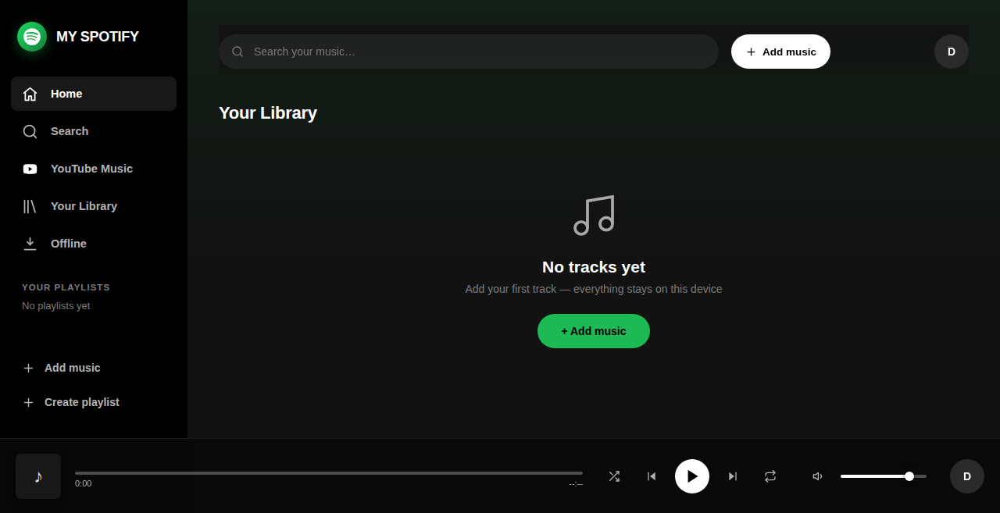

<div align="center">

# 🎵 My Spotify

### Your music. Your server. No subscriptions.

**A self-hosted, zero-dependency music streaming PWA.**
Import from YouTube, upload your own files, and listen anywhere — even offline.


[🚀 Quick Start](#-quick-start) • [✨ Features](#-why-youll-love-it) • [🐳 Docker](#-quick-start-docker) • [⚙️ Setup](#-optional-full-feature-unlock)

</div>

---

> **Try it in 30 seconds:** `git clone` → `node server.js` → open `http://localhost:8378` → done. No npm install. No config files.



## ✨ Why you'll love it

| | |
|---|---|
| 📥 **YouTube Import** | Search, single tracks, or whole playlists in bulk. Import your liked songs + YouTube playlists with Google sign-in. |
| 📱 **Offline-First PWA** | Install it on your phone like a real app. Service worker caches the shell + up to ~600 MB of audio — music keeps playing with no connection. |
| 👥 **Multi-User** | First account becomes admin. Friends & family get their own libraries. Close registrations anytime in admin settings. |
| 🧩 **Zero Dependencies** | The whole server is one file — `server.js` — built only on Node built-ins (`http`, `sqlite`, `crypto`). Nothing to break on update. |
| 🎧 **Real Player** | Dual-deck playback with crossfade + MediaSession, so lock-screen controls just work. |
| 🐳 **Docker or Bare Node** | Run it however you like. Docker image ships with yt-dlp + ffmpeg ready to go. |

---

## 🚀 Quick Start

### Node — no install needed

Requirements: **Node 22.5+** (Node 24 recommended)

```bash
git clone https://github.com/Jblixxkyy/spotify-app.git
cd spotify-app
node server.js
```

Windows: double-click `start.bat` instead. First time? Run `setup-windows.bat` once to fetch `yt-dlp`.

1. Terminal prints a first-run setup code like `ABC-1234`
2. Open `http://localhost:8378` — setup wizard pops up
3. Enter the code + your name / email / password → you're the **admin**

That's it. YouTube search, single downloads, and uploads work out of the box.

### 🐳 Quick Start — Docker

```bash
git clone https://github.com/Jblixxkyy/spotify-app.git
cd spotify-app
docker compose up -d
```

yt-dlp + ffmpeg are preinstalled, so playlist imports work immediately. Data persists in `./data`. Then do the same setup wizard at `http://localhost:8378`.

> Tip: `docker compose restart` after editing source — the server loads code once at startup.

---

## 🎛️ Optional: full feature unlock

<details>
<summary><b>📥 yt-dlp — recommended for playlists</b></summary>

Needed for **playlist / bulk imports** and videos where YouTube wants extra verification.

- Docker: already included
- Windows: run `setup-windows.bat`, or `winget install yt-dlp.yt-dlp`
- Linux / macOS: install `yt-dlp` on your PATH, or set `YTDLP_PATH`

Restart the server after adding / changing yt-dlp — tool lookup is cached.

</details>

<details>
<summary><b>🔑 Google OAuth — import your liked songs</b></summary>

1. Admin → **Server settings** → set **Public address** to the URL users actually visit
2. In [Google Cloud Console](https://console.cloud.google.com/apis/credentials) create an OAuth client with redirect URI `{public address}/auth/google/callback` and scope `youtube.readonly`
3. Paste Client ID + Secret into Server settings

</details>

<details>
<summary><b>🐙 GitHub OAuth</b></summary>

Same idea, redirect URI `{public address}/auth/github/callback`.

</details>

<details>
<summary><b>🔒 HTTPS / remote access</b></summary>

Server speaks plain HTTP — put it behind Caddy, nginx, or Cloudflare Tunnel for TLS, then enable **Secure cookies** in Server settings. PWA install + offline caching need HTTPS (or plain localhost).

</details>

---

## ⚙️ Environment variables — all optional

| Var | Default | Purpose |
|---|---|---|
| `PORT` | `8378` | Listen port |
| `HOST` | `0.0.0.0` | Bind address |
| `PUBLIC_ORIGIN` | from admin settings | Base URL for OAuth redirects |
| `GOOGLE_CLIENT_ID` / `GOOGLE_CLIENT_SECRET` | from admin settings | Google OAuth |
| `GITHUB_CLIENT_ID` / `GITHUB_CLIENT_SECRET` | from admin settings | GitHub OAuth |
| `YTDLP_PATH` / `FFMPEG_PATH` | auto-discovered | Explicit tool paths |
| `YT_MAX_CONCURRENT` | `6` | Max parallel YouTube downloads (1–12) |
| `SETUP_CODE` | random, printed to terminal | Pre-set the first-run admin code |

Everything else — server name, upload limit, open / closed registration, OAuth keys — is in-app under **Admin → Server settings**, stored in SQLite. No config files, no secrets in code.

ffmpeg is optional everywhere — it only enables ReplayGain loudness normalization.

---

## 🗂️ Project layout

```
server.js           Single-file Node server (API, auth, streaming, download jobs)
youtube.js          YouTube helper (search, yt-dlp downloads, InnerTube fallback)
sw.js               Service worker (offline shell + audio cache + background sync)
js/app.js           Frontend app (views, library, uploads, sync queue)
js/audio-engine.js  Dual-deck audio playback (crossfade, MediaSession)
data/               Created at runtime — SQLite DB + audio blobs (gitignored)
```

## 🔐 Security notes

- Server binds `0.0.0.0` by default and YouTube search / browse endpoints are open — don't expose the port to the internet casually; use a reverse proxy with auth if you must.
- All per-user data lives in `data/` (SQLite + audio files). Back that folder up and keep it private.

---

<div align="center">

**Built for people who want their music back.**

⭐ If you like it, star the repo — it helps more people find it.

</div>
